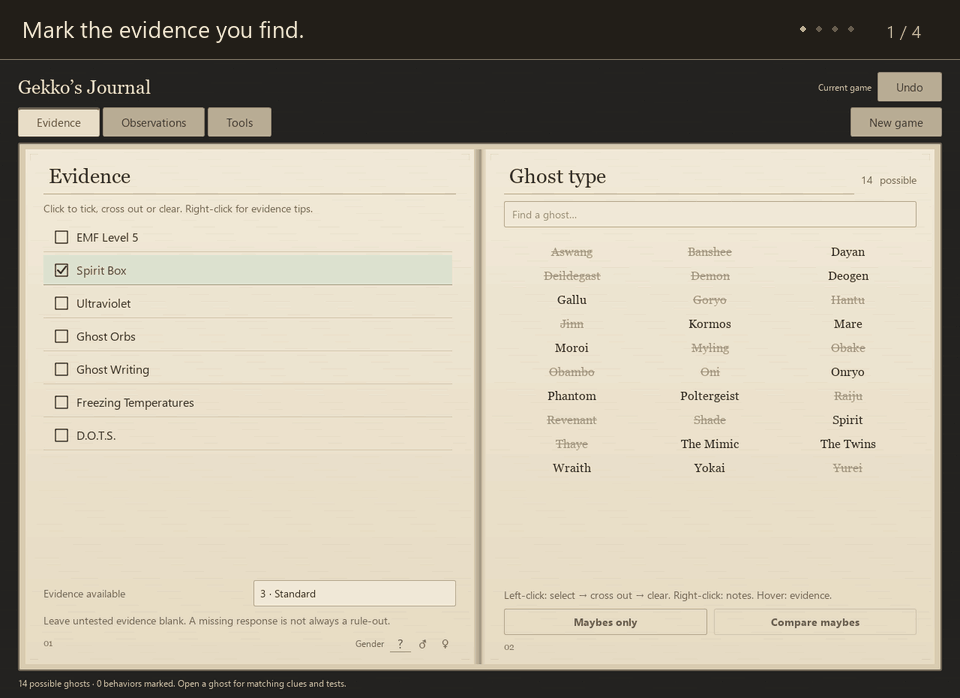

# Gekko’s Journal — Phasmophobia companion

**Track evidence. Test ghosts. Learn as you play.**

A free Phasmophobia companion and cheat sheet for Windows, made for your second monitor. Mark the evidence and hunt behaviour you observe, narrow down the suspects, and choose a practical ghost test. The familiar journal layout keeps clues and guides close at hand.

**[Download Windows setup — recommended](https://github.com/Martin10014/gekkos-journal/releases/download/v0.1.7/Gekkos-Journal-Setup-0.1.7.exe)** · [Portable ZIP](https://github.com/Martin10014/gekkos-journal/releases/download/v0.1.7/Gekkos-Journal-0.1.7-windows-x64.zip) · [All releases](https://github.com/Martin10014/gekkos-journal/releases)

Windows 10/11 · 64-bit · Free to use · Main journal works offline · No account needed

[View a still screenshot](screenshots/journal.png)

## Find your next clue

- **Narrow the suspects:** mark evidence and filter by hunt speed, hunt-start sanity and ghost behaviour. The ghost list follows the same three-column order as the in-game journal, with support for reduced-evidence games.
- **Know what to test:** open practical methods and checklists for all 30 ghosts. Hover a ghost to preview its evidence, or compare suspects side by side.
- **Learn your equipment:** right-click evidence for confirmation and rule-out tips, plus tier 1, 2 and 3 equipment comparisons.
- **Recognise cursed possessions:** pictures of all seven items open offline guides to their uses, costs and hunt triggers, including Tarot Cards and Monkey Paw wishes.
- **Keep useful tools nearby:** incense and hunt timers, manual footstep tapping, pace examples, a sanity estimate and a workspace for your map images.
- **Stay up to date:** a quiet notice tells you when a new version is available. Choose **Update and restart** to install it directly from the journal.

## Get started

1. **Install:** download and run the Windows setup above. A desktop shortcut is optional.
2. **Open:** launch **Gekko’s Journal** from the Start Menu and place it beside your game.
3. **Investigate:** set your evidence allowance, mark what you find, and right-click a ghost for notes and tests. Choose **New game** when you start your next investigation.

<strong>Journal controls and extra tools</strong>

- Left-click a ghost name to cycle **Selected (Maybe) → Crossed out → Clear**. Right-click it to open notes and tests.
- Hover a ghost name to preview its evidence: evidence that does not fit is temporarily crossed out on the left. Moving away restores your view without changing your marks. The Mimic’s preview includes its extra Ghost Orbs.
- Use the small **Gender ? / ♂ / ♀** controls in the Evidence page footer to match the icon beside the ghost’s name in-game. Male rules out Banshee and Dayan; Female adds no rule-outs. Click **?**, or the selected icon again, to clear. Hover for help.
- Right-click an evidence entry for confirmation and rule-out tips, plus equipment comparisons for all three tiers.
- Open **Tools → Reference → Guides → Cursed possessions** to browse the special-item picture gallery.
- Ghost notes, test guides, comparisons and evidence help open in a slide-in panel. Close it or press Escape to return to the book.
- Optional tools include a small always-on-top view, keyboard shortcuts, Windows voice commands and live sharing to a phone or teammates on a trusted private network.
- Smooth mouse-wheel scrolling respects Windows reduced-motion preferences.

<strong>Installation, portable ZIP and Windows requirements</strong>

Setup installs for your Windows account without requesting administrator access. It adds a Start Menu entry and offers an optional desktop shortcut.

Prefer a portable copy? Download the ZIP, extract the **entire folder**, and open **GekkosJournal.exe**. Keep the `_internal` folder beside it. The portable copy does not create shortcuts or an uninstall entry.

Designed for **Windows 10/11, 64-bit (x64)**. Python, an account, an API key and paid credits are not required. The installer and app are unsigned. Windows may show an unfamiliar-app warning, and Smart App Control or managed-PC policies may block them. Verify that the download came from this repository; the release includes SHA-256 checksums.

## A fresh journal every game

Every launch starts a fresh investigation. **New game** clears evidence, gender and other filters, observations, notes, test progress and logs, and resets running tools. There is no saved investigation history.

Appearance and tool preferences are stored locally in `%LOCALAPPDATA%\GekkoJournal`. Imported-map settings can retain the path to an image on your PC. Your image is not bundled with this download or uploaded automatically.

The main journal works offline. Automatic update checks request the latest public release information from GitHub after startup and at most every six hours; they send no journal evidence, notes or investigation data. Turn these checks off in **Tools → Settings → App updates** if preferred. Sharing, global shortcuts and microphone access start disabled; enable them only when you want them. Sharing runs on your trusted network and sends the current journal to connected participants. External reference and release-note links open in your browser when selected. Update downloads begin only when you choose **Update and restart**. There is no analytics service or account system in this app.

## Support Gekko

[Support Gekko on Patreon](https://www.patreon.com/GekkoWasTaken). Optional monthly support helps fund Gekko’s free apps, tools and projects. All journal features and updates stay free for everyone.

## Updates and feedback

Starting with v0.1.5, choose the update notice or **Tools → Settings → App updates → Update and restart**. The journal downloads the matching package from GitHub, checks its size and SHA-256 digest, then closes, updates and reopens. Download progress and cancellation are shown in the app. Preferences are kept; restarting begins a fresh investigation.

Installed copies use the existing per-user installation. Portable copies update their current folder and retain the previous folder beside it as a backup. Unknown files are preserved; if a file name conflicts with the new release, the previous copy remains in the backup. Close any other running copies before updating.

Users on v0.1.5 or later can update directly in the journal now. Users on v0.1.4 or earlier need to install v0.1.7 once to get in-app installation. You can still download and install manually, check for updates in Settings, dismiss a version's notice or turn automatic checks off.

To uninstall an installed copy, open **Windows Settings → Apps**, find **Gekko’s Journal**, and choose **Uninstall**. Uninstalling removes the installed app and its shortcuts; your preferences remain in `%LOCALAPPDATA%\GekkoJournal` for a later reinstall.

For a bug report, include the app version, Windows version, what you did and what you expected. Screenshots help; remove private notes and personal details before posting. Feature suggestions are welcome in [Issues](https://github.com/Martin10014/gekkos-journal/issues).

Found it useful? Share [Gekko’s Journal](https://github.com/Martin10014/gekkos-journal) with your team, or star the repository to find it again.

## License and credits

Gekko’s Journal is **free to use and closed source**. This repository contains the public downloads and documentation. The application’s source code is private. See [LICENSE.txt](LICENSE.txt) for the app’s terms.

The app uses **Qt, PySide6 and Shiboken6 under LGPLv3**, plus other third-party components under their own licenses. Their terms and notices are included in the download’s `licenses` folder. Corresponding Qt/PySide source archives and library replacement instructions are available with each release; those archives contain third-party library source, not Gekko’s Journal’s application source.

The tools are independently implemented, with inspiration from the [Unofficial Phasmo Cheat Sheet](https://tybayn.github.io/phasmo-cheat-sheet/). Small cursed-possession recognition pictures depict Phasmophobia © Kinetic Games Limited, with source captures credited in the download. These images retain their respective owners’ rights; see [image and software credits](THIRD_PARTY_NOTICES.md).

Gekko’s Journal is an unofficial fan tool. It is not affiliated with or endorsed by Kinetic Games. Phasmophobia and related names belong to their respective owners.
