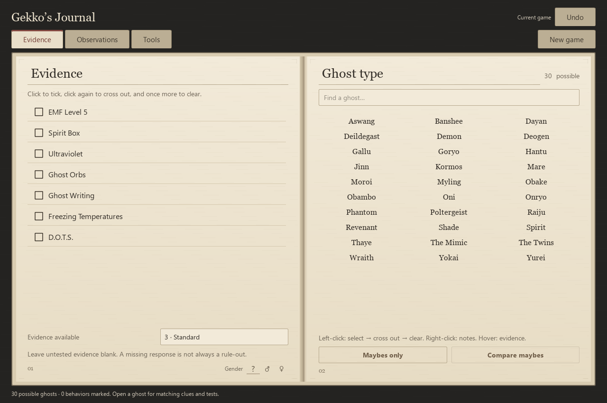

# Gekko’s Journal

A free Windows companion for Phasmophobia. Keep it on your second monitor, mark what you find, and narrow down the ghost with a journal that feels at home beside the game.

**[Download Windows setup — recommended](https://github.com/Martin10014/gekkos-journal/releases/download/v0.1.0/Gekkos-Journal-Setup-0.1.0.exe)** · [Portable ZIP](https://github.com/Martin10014/gekkos-journal/releases/download/v0.1.0/Gekkos-Journal-0.1.0-windows-x64.zip) · [All releases](https://github.com/Martin10014/gekkos-journal/releases)

## Get started

1. Download and open **Gekkos-Journal-Setup-0.1.0.exe**.
2. Follow the setup wizard. It installs for your Windows account without requesting administrator access. A desktop shortcut is optional.
3. Open **Gekko’s Journal** from the Start Menu, or from the desktop if you chose that shortcut.
4. Set your evidence allowance, then mark evidence and observations as you play.

Prefer a portable copy? Download the ZIP, extract the **entire folder**, and open **GekkosJournal.exe**. Keep the `_internal` folder beside it. The portable copy does not create shortcuts or an uninstall entry.

Designed for **Windows 10/11, 64-bit (x64)**. Python, an account, an API key and paid credits are not required. The installer and app are unsigned. Windows may show an unfamiliar-app warning, and Smart App Control or managed-PC policies may block them. Verify that the download came from this repository; the release includes SHA-256 checksums.

## What’s inside

- **Evidence journal:** seven evidence marks, a stable ghost roster, reduced-evidence rules, shortlists and side-by-side comparisons.
- **Behavior clues:** hunt speed, hunt-start sanity, events and ghost-specific observations, with conditions explained beside the clue.
- **Ghost tests:** methods, checklists and interpretation tips for the 30-ghost catalog.
- **Field tools:** incense and hunt timers, manual footstep tapping, synthesized pace examples and a sanity estimate.
- **Reference pages:** original guides, a workspace for your own map images, and links to online references.
- **Optional tools:** a small always-on-top view, keyboard shortcuts, Windows voice commands and live sharing to a phone or teammates on a trusted private network.

This is a **manual companion**. It does not watch your screen, listen for ghost sounds, read game memory or automatically identify a ghost. You make the observations; the journal helps you compare them. Game updates and custom settings can affect the reference advice.

## A fresh journal every game

Every launch starts a fresh investigation. **New game** clears evidence, observations, notes, test progress and logs, and resets running tools. There is no saved investigation history.

Appearance and tool preferences are stored locally in `%LOCALAPPDATA%\GekkoJournal`. Imported-map settings can retain the path to an image on your PC. Your image is not bundled with this download or uploaded automatically.

The main journal works offline. Sharing, global shortcuts and microphone access start disabled; enable them only when you want them. Sharing runs on your trusted network and sends the current journal to connected participants. External reference links open in your browser when selected. There is no analytics service or account system in this app.

## Updates and feedback

For an installed copy, close the journal and run the newer setup file. It updates the installed app while keeping your preferences. There is no automatic updater.

For a portable copy, close the journal and extract the newer ZIP into a new folder. Both editions use the same local preferences folder.

To uninstall an installed copy, open **Windows Settings → Apps**, find **Gekko’s Journal**, and choose **Uninstall**. Uninstalling removes the installed app and its shortcuts; your preferences remain in `%LOCALAPPDATA%\GekkoJournal` for a later reinstall.

For a bug report, include the app version, Windows version, what you did and what you expected. Screenshots help; remove private notes and personal details before posting. Feature suggestions are welcome in [Issues](https://github.com/Martin10014/gekkos-journal/issues).

## License and credits

Gekko’s Journal is **free to use and closed source**. This repository contains the public downloads and documentation. The application’s source code is private. See [LICENSE.txt](LICENSE.txt) for the app’s terms.

The app uses **Qt, PySide6 and Shiboken6 under LGPLv3**, plus other third-party components under their own licenses. Their terms and notices are included in the download’s `licenses` folder. Corresponding Qt/PySide source archives and library replacement instructions are available with each release; those archives contain third-party library source, not Gekko’s Journal’s application source.

The tools are independently implemented, with inspiration from the [Unofficial Phasmo Cheat Sheet](https://tybayn.github.io/phasmo-cheat-sheet/). No game artwork, game audio or third-party cheat-sheet code is bundled.

Gekko’s Journal is an unofficial fan tool. It is not affiliated with or endorsed by Kinetic Games. Phasmophobia and related names belong to their respective owners.
